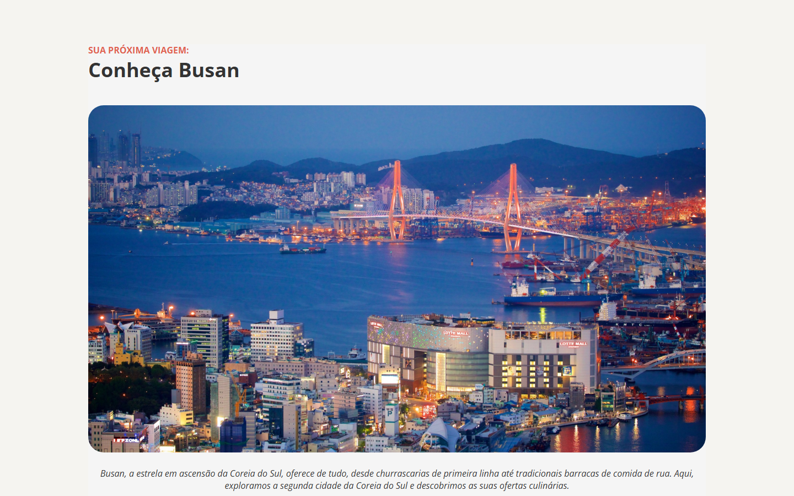

# 🌏 Local Turístico: Busan

Página turística sobre Busan, na Coreia do Sul, apresentando a cidade, sua gastronomia e destinos imperdíveis para quem ama história e cultura.

> 📚 Projeto desenvolvido durante o curso da **Rocketseat**. Layout criado pela Rocketseat, código desenvolvido por mim.

🔗 **Acesse o projeto:** [caioviananog.github.io/projeto-local-turistico](https://caioviananog.github.io/projeto-local-turistico/)



## 🛠️ Tecnologias

- HTML5
- CSS3

## ✨ Funcionalidades

- Seção de destaque com imagem principal da cidade
- Apresentação da gastronomia e cultura local
- Lista de destinos imperdíveis com imagens e descrições

## 📚 O que aprendi

- Estruturar conteúdo com HTML semântico
- Estilizar textos, imagens e espaçamentos com CSS
- Trabalhar com imagens e ícones SVG
- Publicar um site com GitHub Pages

## 🚀 Como rodar localmente

1. Clone o repositório:
   ```bash
   git clone https://github.com/CaioVianaNog/projeto-local-turistico.git
